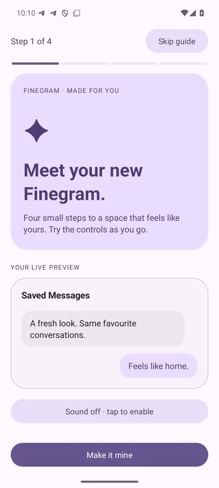
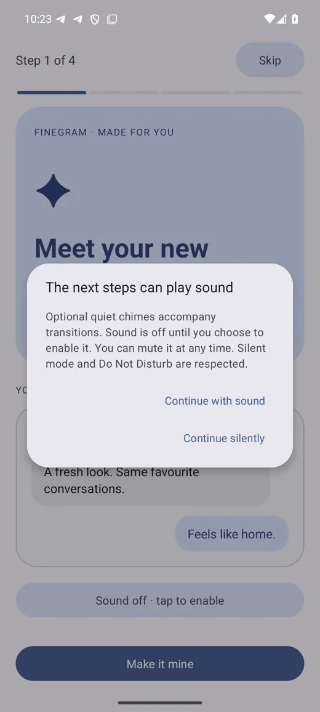
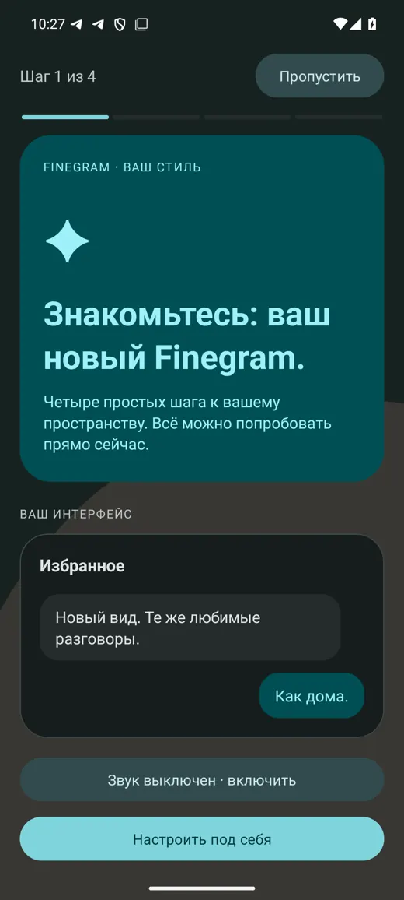

# Material Studio для Finegram

Нативное оформление в духе Pixel / Material You, не веб-оболочка.

## Возможности

- Общие семантические роли цвета Material 3 / HCT для основных поверхностей, текста, сообщений, кнопок и элементов управления. Светлая и тёмная палитры следуют выбранной теме Finegram.
- Шесть акцентов и любой собственный цвет `#RRGGBB`, проверка ввода и живой предпросмотр.
- Material Studio: крупные тональные карточки, скругления, Material-компоненты и безопасные отступы от системных панелей.
- Четырёхшаговое интерактивное руководство с переходами; отключённая системная анимация учитывается.
- Звук выключен по умолчанию. Отдельное предупреждение с вариантами «со звуком» / «без звука». Разрешение не сохраняется между сессиями; при уходе с экрана звук освобождается. Беззвучный режим и DND соблюдаются, громкость устройства не меняется.
- Обои из системного выбора файла, без разрешения на всё хранилище. Копия хранится только в приватном каталоге приложения, уменьшается до 2048 px, учитывает EXIF и не переносит EXIF-метаданные в сохранённый JPEG.
- Единое изображение на основных экранах и фоне чатов по умолчанию. Отдельные обои чатов сохраняют приоритет. Камера, платежи и авторизация не перекрываются фотографией.
- Приглушение 80–95% защищает читаемость текста поверх любых фотографий. Обои можно убрать; настройки — сбросить без изменения аккаунтов и сообщений.

Открыть: **Настройки Finegram → Оформление → Material Studio**. После первого входа в список чатов руководство предлагается автоматически.

## Исправления по обратной связи

### Обои мигают/меняются при переходе в настройки

В `BaseCGPreferencesEntry.updateSettingsColors()` и `SettingsActivity.updateColors()` фон повторно устанавливался сплошным цветом при `onResume`/обновлении темы. Теперь оба пути используют общий `setSurface`, который не заменяет уже подходящие обои. Дополнительно:

- декодирование — одна общая фоновая задача, с очередью ожидающих экранов;
- предзагрузка при старте приложения;
- повторное применение того же изображения/настроек не создаёт новый Drawable;
- кадрирование привязано к окну, а не к высоте конкретного экрана;
- повреждённый файл не запускает бесконечные повторы.

Проверка устранения именно пользовательского мерцания в полноценном Finegram ещё нужна: основная сборка заблокирована ошибкой исходной базы, указанной ниже.

### Не виден прогресс голосового на некоторых темах

Все три ветки установки цветов waveform (входящие, исходящие, предпросмотр ссылки) теперь проверяют контраст с фоном сообщения. Заливка имеет контраст не ниже 4.5:1 с пузырём, пройденная и оставшаяся части — не ниже 3:1, включая выделенные сообщения. Правильные цвета пользовательской темы сохраняются; невидимые получают читаемую замену. Повторные вычисления кешируются. Исправление работает и при выключенном Material-оформлении.

Это проверено математическими тестами; воспроизведение настоящего голосового в полном клиенте ещё не проверено из-за ошибки базы.

## Проверки

```bash
./tools/test-material-palette.sh
./gradlew -p tools/material-preview assembleDebug assembleDebugAndroidTest
```

`tools/material-preview` собирает тот же нативный экран отдельным приложением `com.th3nekit.finegram.materialpreview`, не запрашивает Telegram API-ключи, не содержит аккаунтов и не заменяет установленный Finegram. Это **preview оформления, не полный Telegram-клиент**.

Проверены 8 298 утверждений палитры/контраста текста (518 акцентов × светлая/тёмная тема), 30 000 утверждений контраста голосовых и 218 нативных проверок обоев/настроек на эмуляторе Pixel (Android 15): EXIF, безопасное уменьшение, откат при повреждённом файле, callback на UI-потоке и 100 повторных применений без замены Drawable. UI smoke: все шаги, неверный/верный HEX, явное включение/выключение звука, импорт/перезапуск, русский/английский язык, тёмная тема, увеличенный шрифт и выключенная анимация.

Нативные регрессионные проверки после установки обоих APK:

```bash
adb -s emulator-5554 shell am instrument -w \
  com.th3nekit.finegram.materialpreview.test/com.th3nekit.finegram.materialpreview.MaterialPreviewInstrumentation
```

UI smoke (только отдельный preview в эмуляторе):

```bash
ANDROID_SERIAL=emulator-5554 python3 tools/material-tests/ui_smoke.py
```

Основная Java/Kotlin-компиляция выполнялась командой:

```bash
./gradlew :TMessagesProj:compileDebugJavaWithJavac
```

**Текущий блокер исходной базы:** `FinegramGhostPrefs.java:359` ссылается на отсутствующий `FinegramGhostAttentionSync`. Этого класса нет в исходном коммите `bf3518ffc445a2682063b7cb3c1732e5e4cca645`. Приватность/ghost-логику не подменяли заглушкой ради зелёной сборки. Поэтому полноценный APK и проверка реальных чатов пока не подтверждены.

Также нормализованы окончания строк `gradlew`: исходный `bash\r` не запускался в Linux.

## Нативные скриншоты проверки

Скриншоты сделаны в отдельном read-only эмуляторе Pixel. Данные сообщений и картинка обоев — тестовые.







Остальные состояния: [screenshots](screenshots).
